# Diagramas UML - Proyecto Etapa 2
**Simulador de Sistema Hospitalario**  
*Programación Orientada a Objetos - Grupo 7*  

---

## 1. Diagrama de Paquetes

```mermaid
packageDiagram
    package interfaces {
        class AtencionMedica <<interface>>
    }

    package pacientes {
        class Paciente <<abstract>>
        class PacienteGeneral
        class PacienteEspecialidad
    }

    package personal {
        class Medico <<abstract>>
        class MedicoGeneral
        class MedicoEspecialista
        class Enfermero <<abstract>>
        class EnfermeroEspecialista
        class JefeEnfermeria
    }

    package sistema {
        class Sistema
    }

    package main {
        class Main
    }

    personal ..|> interfaces : implements
    personal --> pacientes : asigna y atiende
    sistema o-- personal : administra
    sistema o-- pacientes : registra
    pacientes ..> sistema : solicita atencion
    main ..> sistema : inicializa y controla
```

---

## 2. Diagrama de Clases UML Detallado (Encapsulamiento Estricto con `private`)

```mermaid
classDiagram
    %% INTERFAZ
    class AtencionMedica {
        <<interface>>
        +darConsulta(Paciente paciente)* void
        +darTratamiento(Paciente paciente)* void
        +darTratamiento(Paciente paciente, String indicacion)* void
    }

    class Comparable~Paciente~ {
        <<interface>>
        +compareTo(Paciente otro)* int
    }

    %% JERARQUÍA PACIENTES
    class Paciente {
        <<abstract>>
        -String nombre
        -String especialidad
        -String tratamiento
        -boolean estaEnConsulta
        -boolean estaEnTratamiento
        +Paciente(String nombre, String especialidad)
        +getNombre() String
        +setNombre(String nombre) void
        +getEspecialidad() String
        +setEspecialidad(String especialidad) void
        +getTratamiento() String
        +setTratamiento(String tratamiento) void
        +isEstaEnConsulta() boolean
        +setEstaEnConsulta(boolean estaEnConsulta) void
        +isEstaEnTratamiento() boolean
        +setEstaEnTratamiento(boolean estaEnTratamiento) void
        +registroEnSistema(Sistema sistema) void
        +solicitarConsulta(Sistema sistema)* void
        +obtenerTipoCondicion()* String
        +verTratamiento() void
        +compareTo(Paciente otro) int
    }

    class PacienteGeneral {
        -String motivoConsulta
        +PacienteGeneral(String nombre, String motivoConsulta)
        +getMotivoConsulta() String
        +setMotivoConsulta(String motivoConsulta) void
        +solicitarConsulta(Sistema sistema) void
        +obtenerTipoCondicion() String
        +actualizarMotivo(String nuevoMotivo) void
    }

    class PacienteEspecialidad {
        -int nivelUrgencia
        -String diagnosticoPrevio
        +PacienteEspecialidad(String nombre, String especialidad, int nivelUrgencia, String diagnosticoPrevio)
        +getNivelUrgencia() int
        +setNivelUrgencia(int nivelUrgencia) void
        +getDiagnosticoPrevio() String
        +setDiagnosticoPrevio(String diagnosticoPrevio) void
        +solicitarConsulta(Sistema sistema) void
        +obtenerTipoCondicion() String
        +actualizarTriage(int nuevoNivel, String observacion) void
    }

    Comparable~Paciente~ <|.. Paciente
    Paciente <|-- PacienteGeneral
    Paciente <|-- PacienteEspecialidad

    %% JERARQUÍA MÉDICOS
    class Medico {
        <<abstract>>
        -String nombre
        -final String cedula
        -String especialidad
        -int noPacientes
        -Paciente[] pacientesAsignados
        -Paciente pacienteEnConsulta
        +Medico(String nombre, String cedula, String especialidad)
        +getNombre() String
        +setNombre(String nombre) void
        +getCedula() String
        +getEspecialidad() String
        +setEspecialidad(String especialidad) void
        +getNoPacientes() int
        +getPacientesAsignados() Paciente[]
        +getPacienteEnConsulta() Paciente
        +setPacienteEnConsulta(Paciente p) void
        +registroEnSistema(Sistema sistema) void
        +solicitarPaciente(Sistema sistema) void
        +puedeAtender(Paciente paciente)* boolean
        +admitirPaciente(Paciente paciente) boolean
        +darConsulta(Paciente paciente) void
        +darTratamiento(Paciente paciente) void
        +darTratamiento(Paciente paciente, String indicacion) void
        +verListaPacientes() void
        +getTipoMedico()* String
    }

    class MedicoGeneral {
        -String consultorioAsignado
        +MedicoGeneral(String nombre, String cedula, String consultorioAsignado)
        +getConsultorioAsignado() String
        +setConsultorioAsignado(String consultorioAsignado) void
        +puedeAtender(Paciente paciente) boolean
        +darConsulta(Paciente paciente) void
        +derivarAEspecialista(Paciente paciente, String especialidadRequerida) void
        +getTipoMedico() String
    }

    class MedicoEspecialista {
        -int aniosExperiencia
        -String subespecialidad
        +MedicoEspecialista(String nombre, String cedula, String especialidad, int aniosExperiencia, String subespecialidad)
        +getAniosExperiencia() int
        +setAniosExperiencia(int aniosExperiencia) void
        +getSubespecialidad() String
        +setSubespecialidad(String subespecialidad) void
        +puedeAtender(Paciente paciente) boolean
        +darConsulta(Paciente paciente) void
        +darTratamiento(Paciente paciente, String indicacion) void
        +emitirDictamenEspecializado(Paciente paciente, String procedimiento) void
        +getTipoMedico() String
    }

    AtencionMedica <|.. Medico
    Medico <|-- MedicoGeneral
    Medico <|-- MedicoEspecialista

    %% JERARQUÍA ENFERMEROS
    class Enfermero {
        <<abstract>>
        -String nombre
        -final String cedula
        -String especialidad
        -int noPacientes
        -Paciente[] pacientesAsignados
        +Enfermero(String nombre, String cedula, String especialidad)
        +getNombre() String
        +setNombre(String nombre) void
        +getCedula() String
        +getEspecialidad() String
        +setEspecialidad(String especialidad) void
        +getNoPacientes() int
        +getPacientesAsignados() Paciente[]
        +registroEnSistema(Sistema sistema) void
        +puedeAtender(Paciente paciente)* boolean
        +admitirPaciente(Paciente paciente) boolean
        +darConsulta(Paciente paciente) void
        +darTratamiento(Paciente paciente) void
        +darTratamiento(Paciente paciente, String indicacion) void
        +verListaPacientes() void
        +getCargo()* String
    }

    class EnfermeroEspecialista {
        -String certificacionAvanzada
        +EnfermeroEspecialista(String nombre, String cedula, String especialidad, String certificacionAvanzada)
        +getCertificacionAvanzada() String
        +setCertificacionAvanzada(String certificacionAvanzada) void
        +puedeAtender(Paciente paciente) boolean
        +darTratamiento(Paciente paciente) void
        +monitoreoIntensivo(Paciente paciente) void
        +getCargo() String
    }

    class JefeEnfermeria {
        -String turnoSupervision
        -int pisoAsignado
        +JefeEnfermeria(String nombre, String cedula, String turnoSupervision, int pisoAsignado)
        +getTurnoSupervision() String
        +setTurnoSupervision(String turnoSupervision) void
        +getPisoAsignado() int
        +setPisoAsignado(int pisoAsignado) void
        +puedeAtender(Paciente paciente) boolean
        +darConsulta(Paciente paciente) void
        +supervisarGuardia(Enfermero[] enfermeros, int totalEnfermeros) void
        +getCargo() String
    }

    AtencionMedica <|.. Enfermero
    Enfermero <|-- EnfermeroEspecialista
    Enfermero <|-- JefeEnfermeria

    %% CLASE SISTEMA
    class Sistema {
        -String nombreHospital
        -Medico[] medicos
        -int noMedicos
        -Enfermero[] enfermeros
        -int noEnfermeros
        -Paciente[] pacientes
        -int noPacientes
        +Sistema(String nombreHospital)
        +Sistema()
        +getNombreHospital() String
        +setNombreHospital(String nombreHospital) void
        +getMedicos() Medico[]
        +getNoMedicos() int
        +getEnfermeros() Enfermero[]
        +getNoEnfermeros() int
        +getPacientes() Paciente[]
        +getNoPacientes() int
        +registrarMedico(Medico medico) void
        +registrarEnfermero(Enfermero enfermero) void
        +registrarPaciente(Paciente paciente) void
        +asignarPaciente(Paciente paciente, Medico medico) void
        +asignarPaciente(Paciente paciente, Enfermero enfermero) void
        +asignarPacienteAutomatico(Paciente paciente) void
        +mostrarEstadisticas() void
    }

    Sistema o-- Medico : almacena polimorficamente
    Sistema o-- Enfermero : almacena polimorficamente
    Sistema o-- Paciente : almacena polimorficamente
```


